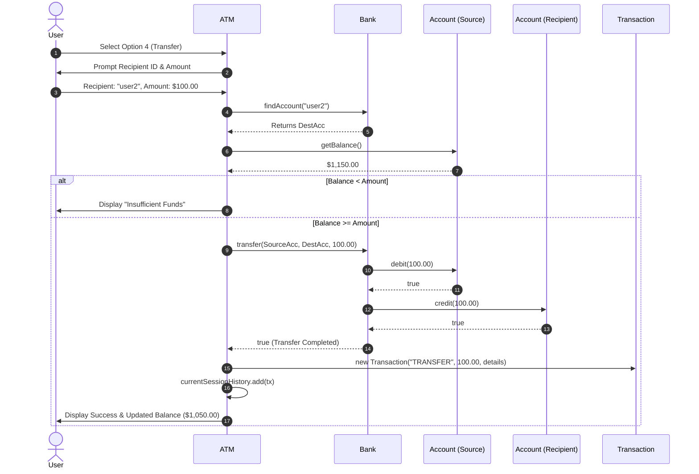

# 🏛️ Architecture & System Design Documentation

This document provides a comprehensive technical overview of the **Console ATM Machine Simulation**. It details the software architecture, design patterns, domain models, interaction workflows, and principles applied throughout the codebase.

---

## 1. Architectural Philosophy & Principles

The system was designed following fundamental software engineering and **SOLID** principles:

| Principle | Implementation in This Project |
| :--- | :--- |
| **Single Responsibility (SRP)** | Each class has a single, well-defined reason to change. `Account` models customer state, `Bank` acts as repository and transfer coordinator, `Transaction` is an immutable audit record, `ATM` handles console presentation and user workflow, and `Main` serves as the composition root. |
| **Encapsulation & Data Hiding** | Account balances and credentials are strictly `private`. No public setters exist for financial balances; modifications can only occur via `debit(double)` and `credit(double)`. |
| **Separation of Concerns (SoC)** | Presentation logic (`ATM`) is completely separated from domain logic and state persistence (`Bank`, `Account`). The ATM does not mutate account variables directly. |
| **Defensive Programming** | Multi-tier validation: The presentation layer verifies inputs, while the domain layer (`Account`, `Bank`) independently verifies amounts and balance availability before executing operations. |

---

## 2. High-Level System Architecture

```mermaid
graph TD
    subgraph Bootstrapping
        M["Main (Entry Point)"]
    end

    subgraph Presentation_Layer
        ATM["ATM Controller\n- Scanner Input\n- Authentication Lockout\n- Menu Switch Loop\n- Session History"]
    end

    subgraph Domain_Services
        B["Bank Repository\n- Account Index\n- Atomic Transfer Service"]
    end

    subgraph Domain_Entities
        A["Account\n- userId\n- pin\n- balance\n- debit() / credit()"]
        T["Transaction (Value Object)\n- type, amount, timestamp\n- details, toString()"]
    end

    M -->|Instantiates & Injects| B
    M -->|Instantiates & Injects Bank| ATM
    M -->|Calls start()| ATM

    ATM -->|Queries & Authenticates| B
    ATM -->|Tracks Session History| T
    ATM -->|Direct Deposit/Withdrawal| A
    ATM -->|Coordinates Transfer| B

    B -->|Aggregates / Looks Up| A
```

---

## 3. Class-by-Class Technical Specifications

### 3.1 `Main.java` — Composition Root
* **Purpose**: Bootstraps the application dependencies and triggers the main lifecycle.
* **Role**:
  * Instantiates the core `Bank` service.
  * Injects `Bank` into the `ATM` presentation controller.
  * Invokes `atm.start()` to begin user interaction.

### 3.2 `Account.java` — Domain Entity
* **Purpose**: Encapsulates customer identity, authentication credentials, and monetary balance.
* **Key Invariants**:
  * Balance cannot be negative.
  * PIN and User ID cannot be null or blank.
* **Encapsulation Safeguards**:
  * Balance has **no public setter**.
  * `debit(double amount)`: Validates that `amount > 0` and `balance >= amount` before subtracting. Returns a `boolean` status.
  * `credit(double amount)`: Validates that `amount > 0` before adding. Returns a `boolean` status.
  * `validatePin(String enteredPin)`: Validates identity using constant-value equality without exposing the private PIN field to the caller.

### 3.3 `Transaction.java` — Immutable Value Object
* **Purpose**: Represents an immutable log of a financial event for audit and session tracking.
* **Attributes**:
  * `type`: Type descriptor (`"WITHDRAW"`, `"DEPOSIT"`, `"TRANSFER"`).
  * `amount`: Numeric transaction value.
  * `timestamp`: Captured automatically upon construction using `LocalDateTime.now()`.
  * `details`: Descriptive context (e.g., recipient ID, post-transaction balance).
* **Display Formatting**: Overrides `toString()` using `DateTimeFormatter` to output aligned, standardized tabular rows.

### 3.4 `Bank.java` — Domain Service & Repository
* **Purpose**: Holds the master list of accounts and coordinates operations involving multiple accounts.
* **Key Responsibilities**:
  * Seeds mock customer accounts on construction.
  * `findAccount(String userId)`: Performs case-insensitive lookup.
  * `transfer(Account from, Account to, double amount)`:
    1. Verifies accounts are non-null and distinct (prevents self-transfer).
    2. Validates positive amount.
    3. Verifies `from.getBalance() >= amount` prior to debiting.
    4. Performs atomic debit on source account and credit on destination account.

### 3.5 `ATM.java` — Presentation & Session Controller
* **Purpose**: Directs console I/O, controls authentication attempts, and drives the interactive menu.
* **State Management**:
  * `Bank bank`: Reference to backend bank services.
  * `Scanner scanner`: Standard input handler.
  * `Account currentAccount`: Reference to the currently authenticated account.
  * `ArrayList<Transaction> currentSessionHistory`: Session-isolated transaction collection. Resets on each successful login to safeguard privacy.
* **Control Flow**:
  * `start()`: Authentication loop enforcing a 3-attempt limit.
  * `showMenu()`: Infinite loop running a clean `switch-case` construct until Option 5 (`Quit`) is selected.

---

## 4. Sequence Diagrams

### 4.1 Authentication Workflow (With 3-Attempt Lockout)

```mermaid
sequenceDiagram
    autonumber
    actor User
    participant ATM
    participant Bank
    participant Account

    User->>ATM: Launch Application (start())
    loop Max 3 Attempts
        User->>ATM: Enters User ID & PIN
        ATM->>Bank: findAccount(userId)
        alt Account Exists
            Bank-->>ATM: Returns Account instance
            ATM->>Account: validatePin(enteredPin)
            alt PIN is Valid
                Account-->>ATM: true
                Note over ATM: Authentication Successful
                ATM->>ATM: Clear session history
                ATM->>ATM: showMenu()
            else PIN is Invalid
                Account-->>ATM: false
                Note over ATM: Decrement attempts; prompt retry
            end
        else Account Not Found
            Bank-->>ATM: null
            Note over ATM: Decrement attempts; prompt retry
        end
    end
    Note over ATM: 3 Failed Attempts reached -> [ACCESS DENIED] & System Exit
```

---

### 4.2 Funds Transfer Workflow (Atomic Debit & Credit)



---

## 5. Input Handling & Robustness Strategy

### 5.1 Eliminating Scanner Newline Pitfalls
In console Java applications, mixing `scanner.nextInt()` or `scanner.nextDouble()` with `scanner.nextLine()` frequently leads to skipped prompts due to residual `\n` characters in the input buffer.

**Architectural Solution**:
The application reads all console input exclusively through `scanner.nextLine().trim()`. Numeric values are parsed using `Integer.parseInt()` or `Double.parseDouble()` within isolated `try-catch` blocks.

```java
// Example safe parsing mechanism in ATM.java
try {
    double amount = Double.parseDouble(line);
    if (amount <= 0.0) {
        System.out.println("Error: Amount must be greater than zero.");
        continue;
    }
    return amount;
} catch (NumberFormatException e) {
    System.out.println("Error: Invalid numeric input.");
}
```

### 5.2 Two-Tier Balance Verification
To meet financial safety and requirement criteria:
1. **Presentation Tier (`ATM.java`)**: Checks `currentAccount.getBalance() < amount` before executing withdrawals or transfers. If violated, it prints the required phrase:
   ```text
   Insufficient Funds
   ```
2. **Domain Tier (`Account.java` & `Bank.java`)**: Evaluates `balance >= amount` as an internal invariant inside `debit()`. If called improperly, it fails gracefully without altering state.

---

## 6. Future Scalability Roadmap

For enterprise-scale evolution, the current architecture easily accommodates the following patterns:

1. **Repository Pattern with Database / ORM**:
   Replace `ArrayList<Account>` in `Bank` with a `BankRepository` interface backed by Spring Data JPA / JDBC / Hibernate.
2. **High-Precision Financial Arithmetic**:
   Replace `double` with `java.math.BigDecimal` to eliminate binary floating-point rounding inaccuracies in high-volume currency calculations.
3. **Thread Safety & Concurrent Transactions**:
   Introduce synchronized blocks, `ReentrantLock`, or database row-level locking during `Bank.transfer()` to prevent race conditions during concurrent ATM terminal access.

